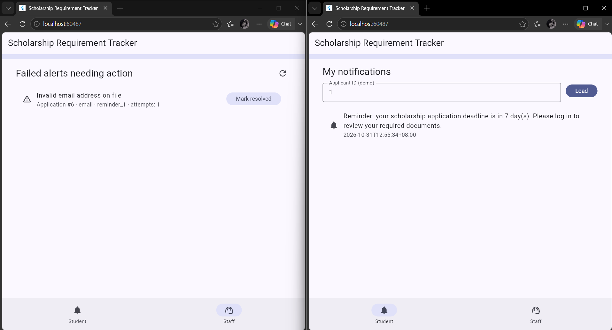

# Week 13 – Workflow Boundary and Trigger Decision

**Project:** Scholarship Requirement Tracker (Project 9)
**Module:** Advanced Automation and Scripting (SA7)
**Status:** Draft v1 – update the commit/tag reference when you submit

## 1. Purpose
Reduce missed documents and missed deadlines by automating reminders, review-related alerts, and safe status notifications for a university scholarship office.

## 2. Actors
| Actor | Role in the automation |
|---|---|
| Student / applicant | Receives reminders and status alerts (in-app and email) |
| Scholarship staff | Assigns reviewers manually; receives unassigned/stale alerts and the failed-alert queue |
| Reviewer | Receives an alert when an application is assigned to them |
| System administrator | Out of scope for Week 13 automation (accounts and roles arrive in Week 14) |

## 3. Boundary
### In scope (Week 13)
- **A1 – Deadline and missing-document reminders:** sent 7, 3, and 1 day before the scholarship deadline to applicants who still have missing or rejected required documents.
- **A2 – Reviewer assignment alert:** when staff assign an application, the reviewer is notified.
- **A3 – Stale application alert:** staff are notified when an application has been unassigned or unreviewed longer than a configured number of days.
- **A4 – Safe status notification:** when an application status changes, the applicant gets a generic notification.
- **Retry and recovery** for outbound notifications, and routing of permanent failures to a staff queue.

### Out of scope
- Automatic reviewer assignment (staff assign manually)
- SMS or push notifications
- Per-document deadlines (one deadline per scholarship)
- Authentication and role-based authorization (Week 14)
- Analytics dashboards and any production deployment

## 4. Trigger Decision
| Option | Description | Decision |
|---|---|---|
| Scheduled job (Laravel scheduler, daily) | Runs once a day and finds applicants due for a reminder | **Chosen for A1 and A3** |
| Event-driven (dispatch on a state change) | Runs when staff assign a reviewer or a status changes | **Chosen for A2 and A4** |
| Delayed per-application queue jobs | One delayed job per applicant per reminder | Rejected: hard to reschedule when a deadline changes, and more moving parts |
| External automation service | Third-party workflow tool | Rejected: unnecessary dependency, extra secrets, harder to defend |

**Rationale:** reminders depend on the calendar, so a daily scheduler is predictable, easy to test, and easy to re-run safely. Assignment and status alerts depend on an action, so they should fire immediately from that event.

## 5. Bounds (what keeps the automation safe)
- **Idempotency:** one reminder per applicant, scholarship, and offset (7/3/1). A repeated run must not send duplicates.
- **Maximum volume:** at most 3 reminders per applicant per scholarship deadline.
- **Eligibility:** only applicants with missing or rejected documents, only for open scholarships, and only before the deadline.
- **Batch limit:** the daily job processes records in fixed-size batches.
- **Retry cap:** each notification is attempted at most 3 times, with increasing delay between attempts (shortened through configuration for demonstration).
- **Stop condition:** after the retry cap, the notification is marked permanently failed and routed to the staff queue, with no further automatic attempts.
- **Controlled data only:** seeded fake applicants and fake email addresses.

## 6. Safety Rules
- Notification text is generic, for example "Your application status has been updated." It never contains Approved, Rejected, or Waitlisted.
- Document-rejection remarks describe the document only and never the scholarship decision.
- Logs contain identifiers, not names, email addresses, or document contents.
- Mail credentials live only in `.env` (never committed); the repository holds `.env.example` with placeholders.

## 7. Observability
Every automation step writes one structured JSON log line with:
`timestamp`, `automation` (A1–A4), `event`, `applicant_id`/`application_id`, `channel` (in_app|email), `attempt`, `outcome` (sent|retry|recovered|failed_permanent), `error_code`, `correlation_id`.

## 8. Expected Evidence for This Week
1. Success: a reminder delivered on both channels.

   

## 9. Assumptions and Open Issues
- Reviewer and staff permissions are finalized in Week 14.
- Decision details appear only inside the authenticated app, which is fully secured from Week 14 onward.
- Scheduler time zone is Asia/Manila.
