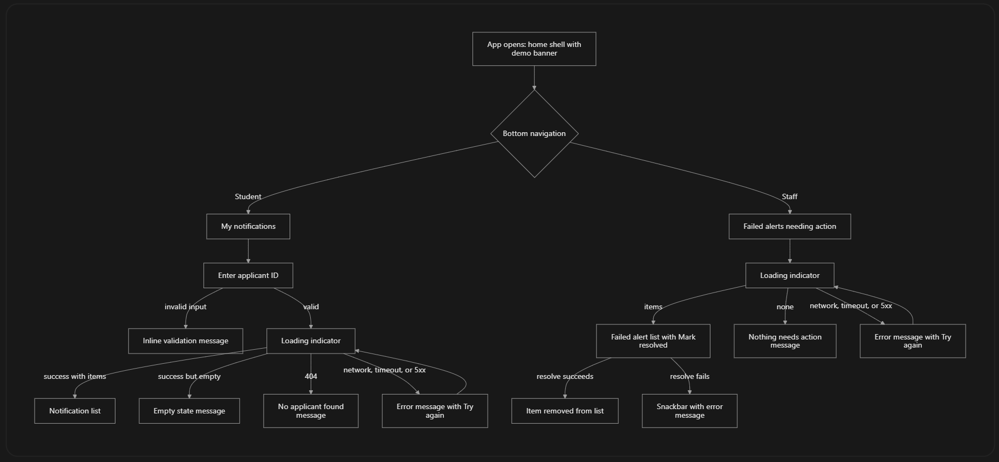

# Week 13 – Flutter Web Screen Flow and UI States

**Project:** Scholarship Requirement Tracker (Project 9) · **Module:** Advanced Automation and Scripting (SA7)
**Build:** `<BUILD_COMMIT>` · **Browser tested:** Microsoft Edge (Windows) · **Date:** 2026-10-30

## 1. Scope of this document
This document sketches the full intended screen flow of the system and states which screens exist in the Week 13 build. Week 13 implements only the two screens that exercise the automation: **Student notifications** and **Staff failed alerts**. All other screens are planned work for later weeks and are marked as such.

## 2. Screen flow implemented in Week 13



## 3. Wireframes (implemented screens)

```
Student tab                               Staff tab
+------------------------------------+    +------------------------------------+
| Scholarship Requirement Tracker    |    | Scholarship Requirement Tracker    |
| [Week 13 demo banner]              |    | [Week 13 demo banner]              |
|                                    |    |                                    |
| My notifications                   |    | Failed alerts needing action  [↻]  |
| [Applicant ID (demo)   ] [Load]    |    | ---------------------------------- |
| ---------------------------------- |    | ⚠ Invalid email address on file    |
| 🔔 Reminder: your deadline is in   |    |   Application #6 · email ·         |
|    7 day(s). Please log in...      |    |   reminder_1 · attempts: 1         |
|    2026-10-30T...                  |    |                [Mark resolved]     |
| 🔔 Your application status has     |    |                                    |
|    been updated. Please log in...  |    |                                    |
|------------------------------------|    |------------------------------------|
| [Student]            [Staff]       |    | [Student]            [Staff]       |
+------------------------------------+    +------------------------------------+
```

## 4. Required UI states

| State | Student notifications | Staff failed alerts |
|---|---|---|
| Loading | Spinner while the request runs; Load button disabled | Spinner on open and on refresh |
| Success | List of generic notification messages | List of unresolved failed alerts |
| Empty | "No notifications yet." | "No failed alerts. Nothing needs action." |
| Validation | ID must be a positive whole number; invalid input is blocked in the client and no request is sent | Not applicable (no free-text input) |
| Not found | "No applicant found with that ID." (HTTP 404) | Not applicable |
| Conflict | Not applicable | Resolve on an already-resolved item shows the server message in a snackbar (HTTP 409) |
| Network error | "Cannot reach the server..." with Try again; also shown on timeout (10 s) | Same |
| Server error | Safe generic message with the status code, with Try again. Handled in code; **not demonstrated** in Week 13 evidence | Same |
| Authorization | **Not applicable in Week 13.** There is no sign-in yet, and the banner says so. Added in Week 14 | Same |

## 5. Client and server validation
- **Client:** the applicant ID field accepts only positive integers.
- **Server:** the applicant ID is resolved through route-model binding, so unknown IDs return 404. Input bodies (assign reviewer, change status) are validated on the server; no Flutter form for those exists yet, so they are exercised through direct API calls (see `03-api-contract.md`).

## 6. Responsive behavior
Content is centered with a maximum width of 720 px, so it stays readable on wide screens and uses the full width on narrow ones. Navigation is a bottom bar that works at any width.
**Widths checked by the student:** `<fill in, e.g. full-screen desktop and a narrow window ~400 px>` · **Result:** `<fill in>`

## 7. Planned screens (not built in Week 13)

| Screen | Primary user | Planned week |
|---|---|---|
| Sign-in | All roles | 14 |
| Application checklist dashboard (required, missing, rejected documents) | Student | 14–17 |
| Document upload and resubmission | Student | 14–17 |
| Reviewer queue and review detail (reject with remark, record decision) | Reviewer | 14–17 |
| Scholarship setup, requirement rules, reviewer assignment | Staff | 14–17 |
| Account and role management | Administrator | 14 |

## 8. Demo-mode notice
The banner states that sign-in and role checks arrive in Week 14 and that only fake data is used. The student screen identifies the applicant by ID only because there is no authentication yet; this is recorded as a known limitation.
